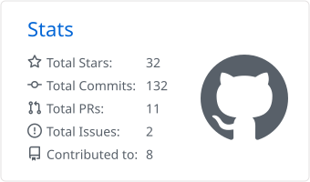
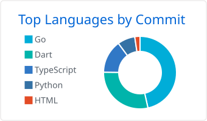

<h2 align="center">Hi, I'm Lysander 👋</h2>

全栈开发 · 服务端 / AI Agent / 大模型部署与推理 / 音视频流媒体 · 海南

  

  <picture>
    <source media="(prefers-color-scheme: dark)" srcset="profile-summary-card-output/github_dark/3-stats.svg">
    
  </picture>
  <picture>
    <source media="(prefers-color-scheme: dark)" srcset="profile-summary-card-output/github_dark/2-most-commit-language.svg">
    
  </picture>

  <picture>
    <source media="(prefers-color-scheme: dark)" srcset="https://raw.githubusercontent.com/Lysander66/Lysander66/output/github-snake-dark.svg">
    
  </picture>

